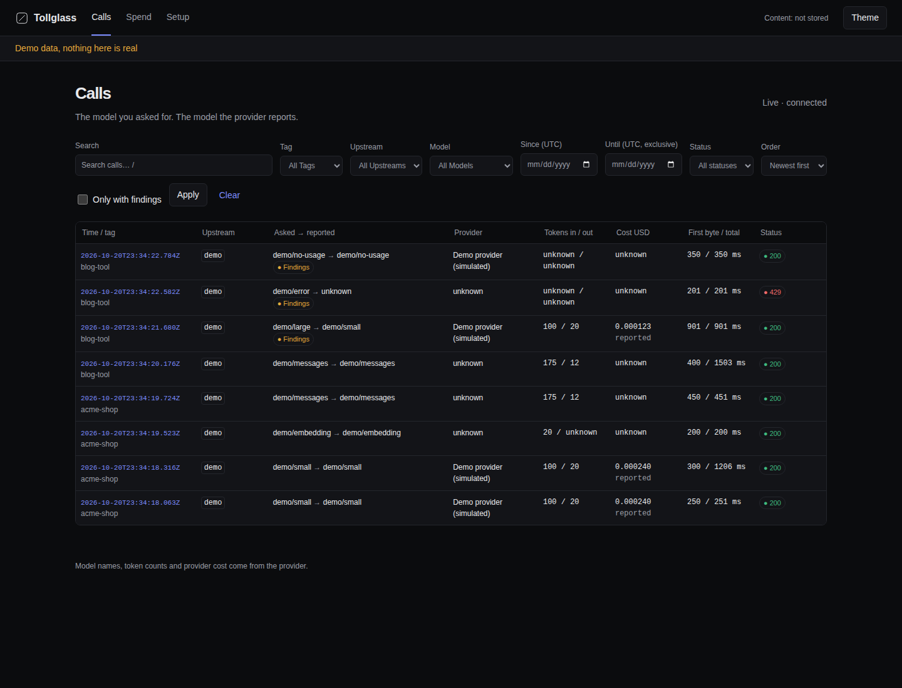
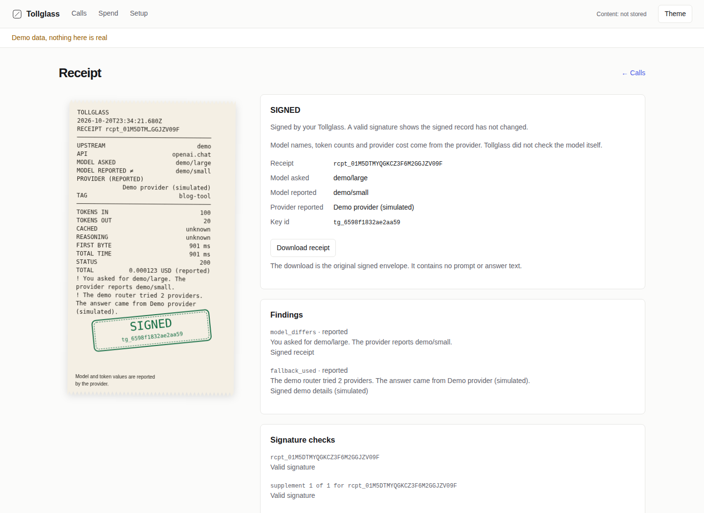

<p align="center">
  <picture>
    <source media="(prefers-color-scheme: dark)" srcset="docs/media/wordmark-dark.svg">
    
  </picture>
</p>

<p align="center"><strong>Receipts for your AI API calls.</strong></p>

Tabslip forwards calls to your AI provider and keeps receipts signed by your Tabslip.

<p align="center"><a href="https://www.tabslip.com">Website</a> · <a href="docs/quickstart.md">Quickstart</a> · <a href="examples/README.md">Examples</a> · <a href="AGENTS.md">AGENTS.md</a></p>





## Set it up with your coding agent

Copy this into your coding agent inside the project you want to connect:

```text
Set up Tabslip for this project.
Use https://github.com/vincentsch/tabslip: read its AGENTS.md and follow
the steps. Route this project's AI API calls through it, make one real call,
and show me the receipt.
```

The agent finds your AI client, keeps its provider and keys, and saves a small base URL change.
It installs or reuses Tabslip, makes one provider call that may cost money, and shows the receipt and undo steps.
Read [what the agent changes](docs/setup-with-an-agent.md).

## Try it without a key

```sh
curl -fsSL https://raw.githubusercontent.com/vincentsch/tabslip/main/install.sh | sh
tabslip demo
```

Open the printed Page URL. The demo sends eight simulated calls, including a
fallback, an error and a call with unknown usage. It makes no external requests.
It prints ready-to-run export and verify commands. Its temporary data directory
is removed on Ctrl+C; use `tabslip demo --data-dir ./demo-data` to keep it.
See the [quickstart](docs/quickstart.md) for installation and demo URLs.

## Connect your app

Start the gateway and open `http://127.0.0.1:4545`:

```sh
tabslip serve
```

Your app keeps its key and provider; only the base URL changes.

| Provider | Client base URL at the default port |
| --- | --- |
| OpenAI | `http://127.0.0.1:4545/openai/v1` |
| OpenRouter | `http://127.0.0.1:4545/openrouter/v1` |
| Ollama | `http://127.0.0.1:4545/ollama/v1` |
| Anthropic | `http://127.0.0.1:4545/anthropic` |

For example, Python OpenAI reads your existing `OPENAI_API_KEY`:

```python
from openai import OpenAI
client = OpenAI(base_url="http://127.0.0.1:4545/openai/v1")
response = client.chat.completions.create(
    model="gpt-4.1", messages=[{"role": "user", "content": "Hello"}])
print(response.choices[0].message.content)
```

This makes a provider call that may cost money. Save the URL in your project's
configuration and keep Tabslip running while the app uses it.
The [quickstart](docs/quickstart.md#connect-your-app) has all four SDK snippets,
plus links to curl and environment examples. See [upstreams](docs/upstreams.md)
for API coverage, custom providers, containers and servers.

The local page stays on loopback. Supported `--listen` values are `127.0.0.1`,
`localhost`, `::1`, `0.0.0.0` and `::`; specific non-loopback binds are rejected.
For containers, use the [networking guide](docs/upstreams.md).

## What a receipt can and can't show

A receipt records requested and reported models, usage, cost and findings.
Model names, tokens and provider cost are reported by the provider.
Tabslip labels its measured times, sizes, hashes and errors as observed.
Missing values stay unknown, never zero. Cost can be reported, estimated from
a versioned price table, or unknown. [Receipt fields](docs/receipts.md) and
[costs](docs/costs.md) explain the details and signed supplements.

A signature shows the receipt has not changed since your Tabslip signed it.
It cannot check the provider's claims or stop the key owner inventing records.
The terminal `show` command checks the receipt and all attached supplements
before printing SIGNED. Failed checks print INVALID and return exit 10;
`show --json` keeps the original base envelope on stdout and reports failed
contributors on stderr. See [sharing and offline verification](docs/verify.md)
for commands and exit codes.

## What stays on your computer

By default, receipts keep metadata and hashes without prompt or answer text.
Optional content storage stays local, for all calls or selected tags, and
never enters downloads or exports. Keys pass through and are never stored.
There is no telemetry. Read [storage and privacy](docs/privacy.md) for local
paths, retention and network contacts.

## Commands and docs

The [command guide](docs/commands.md) covers `serve`, `demo`, `receipts`, `show`,
`export`, `verify`, `key`, `prices` and `doctor`. Start with the
[quickstart](docs/quickstart.md), [FAQ](docs/faq.md) or
[troubleshooting](docs/troubleshooting.md). The [runnable examples](examples/README.md)
include [tested SDK versions](examples/README.md#tested-dependencies).

## Install options

Release binaries need no runtime. The shell installer supports Linux, macOS
and Windows through Git Bash, and checks SHA-256 before replacing a binary.
The [quickstart install section](docs/quickstart.md#install) covers installer
settings, native Windows downloads, checksums, provenance and `go install`.
[CONTRIBUTING.md](CONTRIBUTING.md) covers source builds and development checks.
[RELEASE.md](RELEASE.md) describes release and provenance checks.
Report security issues through [SECURITY.md](SECURITY.md).

## License

[MIT](LICENSE).
