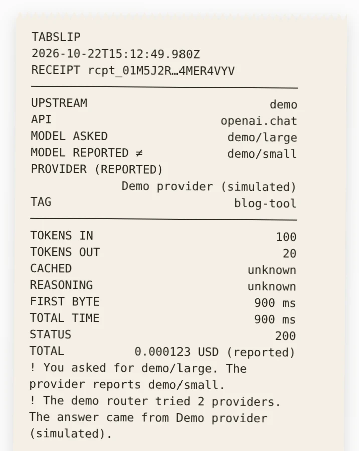

<p align="center">
  <picture>
    <source media="(prefers-color-scheme: dark)" srcset="docs/media/wordmark-dark.svg">
    
  </picture>
</p>

<p align="center"><strong>Receipts for your AI API calls.</strong></p>

Tabslip forwards calls to your AI provider and keeps receipts signed by your Tabslip.

<p align="center"><a href="https://www.tabslip.com">Website</a> · <a href="docs/quickstart.md">Quickstart</a> · <a href="examples/README.md">Examples</a> · <a href="AGENTS.md">AGENTS.md</a></p>

## Set it up with your coding agent

Copy this into your coding agent inside the project you want to connect:

```text
Set up Tabslip for this project.
Use https://github.com/vincentsch/tabslip: read its AGENTS.md and follow
the steps. Route this project's AI API calls through it, make one real call,
and show me the receipt.
```

The agent finds your AI client and saves the base URL change. It installs
Tabslip if needed. Your provider and keys stay the same. It makes one call that
may cost money, then shows the receipt and undo steps. Read [what the agent
changes](docs/setup-with-an-agent.md).

## Try it without a key

```sh
curl -fsSL https://raw.githubusercontent.com/vincentsch/tabslip/main/install.sh | sh
```

If the installer prints a PATH command, run it first. Then start the demo:

```sh
tabslip demo
```

Open the printed Page URL. The demo sends eight simulated calls. It includes a
fallback and a failed call. Another call shows what happens when usage is
unknown. It makes no external requests and prints export and verify commands.
Ctrl+C removes its temporary data directory. Use
`tabslip demo --data-dir ./demo-data` to keep it. See the [quickstart](docs/quickstart.md) for
installation and demo URLs.

<p align="center">
  
</p>

<details>
<summary>See the full Calls page and receipt</summary>


</details>

## Connect your app

Start the gateway and open `http://127.0.0.1:4545`:

```sh
tabslip serve
```

Your app keeps its key and provider; only the base URL changes.

| Provider | Client base URL at the default port |
| --- | --- |
| OpenAI | `http://127.0.0.1:4545/openai/v1` |
| OpenRouter | `http://127.0.0.1:4545/openrouter/v1` |
| Ollama | `http://127.0.0.1:4545/ollama/v1` |
| Anthropic | `http://127.0.0.1:4545/anthropic` |

For example, Python OpenAI reads your existing `OPENAI_API_KEY`:

```python
from openai import OpenAI
client = OpenAI(base_url="http://127.0.0.1:4545/openai/v1")
response = client.chat.completions.create(
    model="gpt-4.1", messages=[{"role": "user", "content": "Hello"}])
print(response.choices[0].message.content)
```

This makes a provider call that may cost money. Save the URL in your project's
configuration and keep Tabslip running while the app uses it. The
[quickstart](docs/quickstart.md#connect-your-app) has all four SDK snippets,
plus links to curl and environment examples. See [upstreams](docs/upstreams.md)
for custom providers or running beside your app in a container or on a server.

The local page stays on loopback. Supported `--listen` values are `127.0.0.1`,
`localhost`, `::1`, `0.0.0.0` and `::`; specific non-loopback binds are rejected.
For containers, use the [networking guide](docs/upstreams.md).

## What a receipt can and can't show

A receipt keeps the model you requested and the one the provider reported. Usage
and provider cost also come from the provider. Tabslip labels its own
measurements as observed; these include timing and body hashes. Findings flag
problems such as a fallback or missing usage. Missing values stay unknown, never
zero. Cost can be reported, estimated from a versioned price table, or unknown.
[Receipt fields](docs/receipts.md) and [costs](docs/costs.md) explain the
details and signed supplements.

A signature shows the receipt has not changed since your Tabslip signed it. It
cannot check the provider's claims or stop the key owner inventing records. The
terminal `show` command checks the receipt and its attached supplements before
printing SIGNED. A failed check prints INVALID. See [sharing and offline
verification](docs/verify.md) for commands and exit codes.

## What stays on your computer

By default, receipts keep metadata and hashes without prompt or answer text.
You can keep prompt and answer text locally for all calls or selected tags.
Downloads and exports exclude this text. Keys pass through and are never stored. There is no
telemetry. Read [storage and privacy](docs/privacy.md) for retention settings
and network contacts.

## Commands and docs

The [command guide](docs/commands.md) lists the commands and links to each
reference page. Start with the [quickstart](docs/quickstart.md),
[FAQ](docs/faq.md) or [troubleshooting](docs/troubleshooting.md). The [runnable
examples](examples/README.md) include [tested SDK
versions](examples/README.md#tested-dependencies).

## Install options

Release binaries need no runtime. The shell installer supports Linux, macOS and
Windows through Git Bash, and checks SHA-256 before replacing a binary. The
[quickstart install section](docs/quickstart.md#more-install-options) covers
alternative install methods and download checks.
[CONTRIBUTING.md](CONTRIBUTING.md) covers source builds and development checks.
[RELEASE.md](RELEASE.md) describes release and provenance checks. Report
security issues through [SECURITY.md](SECURITY.md).

Built with [rungrad](https://rungrad.com).

## License

[MIT](LICENSE). Made by [Vincent
Schmalbach](https://www.vincentschmalbach.com/).
